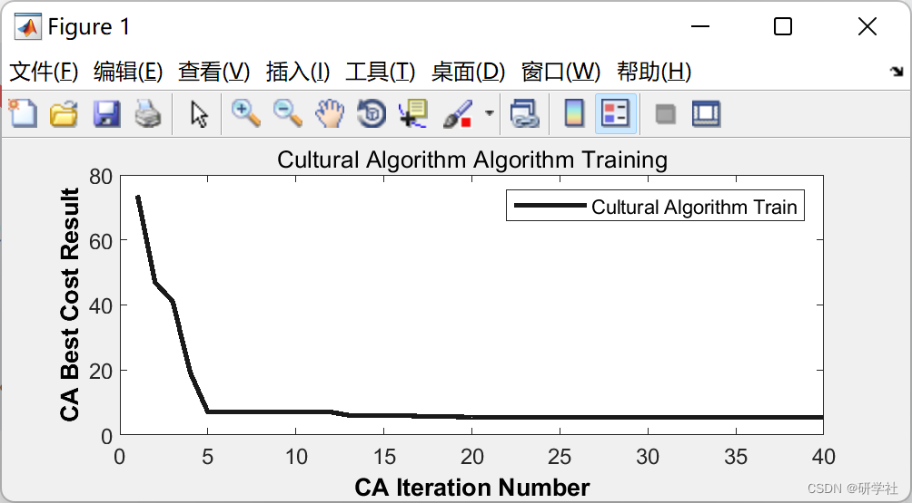
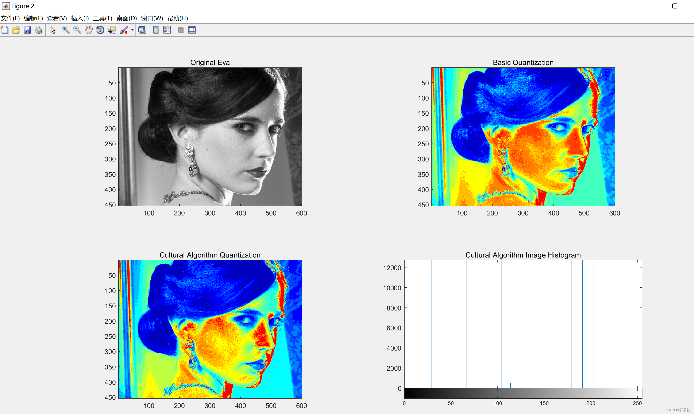
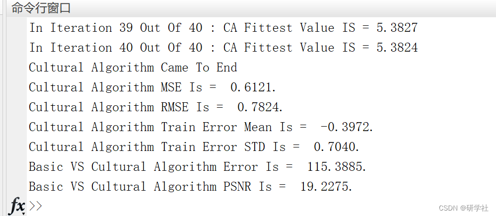

# Image Quantization Based on Cultural Optimization Algorithm (Matlab Code Implementation)

💥💥💞💞 Welcome to this blog❤️❤️💥💥 🏆 Bloggers' Advantages: 🌞🌞🌞 The content of the blog strives for rigorous thinking and clear logic to facilitate readers. ⛳️ Mantra: "A journey of a thousand miles begins with a single step." 📋1 Overview📝2 Run Results📃3 References📋4 Matlab Code Implementation📋1 Overview
In color image processing, the compression storage and transmission of color images are one of the hot topics. Quantization technology is one of the key technologies in the compression processing of 24-bit or higher-bit true color images. Referencing pattern recognition, cluster analysis is a good quantization method. It uses cluster algorithms to group closely related color values into a group, and then replaces them with a single color value. So far, many cluster quantization algorithms have been proposed, such as K-means algorithm, LBG algorithm, fuzzy C-means algorithm, FORGY algorithm, ISODATA algorithm [1-2], whose goal is to minimize the difference between the quantized and unquantized images, that is, to reduce image color number with minimal distortion. From the results, although these methods can achieve satisfactory quantization effects, due to their sensitivity to initial cluster centers selection, different initial cluster centers may lead to different cluster results, which may cause serious distortion when reconstructing color images.
This article implements image quantization based on cultural optimization algorithm using Matlab code. 📝2 Run Results​ Edit
​Edit
​Edit
Part of the code:
I = imread('eva.jpg');  
% Convert To Gray  
I=rgb2gray(I);  
% Basic Multilevel Image Thresholds Using Otsu Method  
Data = multithresh(I,thresholdlvl);  
Data=Data';  
Data=double(Data);
% Creating Inputs and Targets  
Delays = [1];  
[Inputs, Targets] = MakeTheTimeSeries(Data',Delays);  
data.Inputs=Inputs;  
data.Targets=Targets;  
% Making Data  
Inputs=data.Inputs';  
Targets=data.Targets';  
Targets=Targets(:,1);  
nSample=size(Inputs,1);  
% Creating Train Vector  
pTrain=1.0;  
nTrain=round(pTrain*nSample);  
TrainInputs=Inputs(1:nTrain,:);  
TrainTargets=Targets(1:nTrain,:);  
TestInputs=Inputs(nTrain+1:end,:);  
TestTargets=Targets(nTrain+1:end,:);  
% Making Final Data Struct  
data.TrainInputs=TrainInputs;  
data.TrainTargets=TrainTargets;  
data.TestInputs=TestInputs;  
data.TestTargets=TestTargets;  
%% Basic Fuzzy Model Creation  
% Number of Clusters in FCM  
ClusNum=2;  
%  
% Creating FIS  
fis=GenerateFuzzy(data,ClusNum);  
%% Tarining Cultural Algorithm  
CulturalAlgorithmFis = CulturalFCN(fis,data);  
%% Train Output Extraction  
TrTar=data.TrainTargets;  
TrainOutputs=evalfis(data.TrainInputs,CulturalAlgorithmFis);  
% Train calculation  
Errors=data.TrainTargets-TrainOutputs;  
r0 = -1 ;  
r1 = +1 ;  
range = max(Errors) - min(Errors);  
Errors = (Errors - min(Errors)) / range;  
range2 = r1-r0;  
Errors = (Errors * range2) + r0;  
MSE=mean(Errors.^2);  
RMSE=sqrt(MSE);  
error_mean=mean(Errors);  
error_std=std(Errors);  
%% Results  
% Basic Image Quantization  
seg_I = imquantize(I,Data);  
RGB = label2rgb(seg_I);  
% Cultural Algorithm Image Quantization  
TrainOutputs(thresholdlvl)=TrainOutputs(end)+1;  
TrainOutputs=sort(TrainOutputs);  
seg_I2 = imquantize(I,TrainOutputs);  
RGB2 = label2rgb(seg_I2);  
% Plot Results  
figure('units','normalized','outerposition',[0 0 1 1])  
subplot(2,2,1)  
subimage(I); title('Original Eva');  
subplot(2,2,2)  
subimage(RGB);title('Basic Quantization');  
subplot(2,2,3)  
subimage(RGB2);title('Cultural Algorithm Quantization');  
subplot(2,2,4)  
imhist(rgb2gray(RGB2));title('Cultural Algorithm Image Histogram');  
%% Cultural Algorithm Image Quantization Performance Statistics  
fprintf('Cultural Algorithm MSE Is = %0.4f.\n',MSE)  
fprintf('Cultural Algorithm RMSE Is = %0.4f.\n',RMSE)  
fprintf('Cultural Algorithm Train Error Mean Is = %0.4f.\n',error_mean)  
fprintf('Cultural Algorithm Train Error STD Is = %0.4f.\n',error_std)  
📃3 References [1] Xu Yongfeng, Jiang Zhenyi. A K-means Color Image Quantization Algorithm Based on Particle Swarm Optimization [J]. Northwestern University Journal of Natural Sciences, 2012, 42(3): 351-354
[2]Seyed Muhammad Hossein Mousavi (2022). Cultural Algorithm Image Quantization  
📋4 Matlab code implementation

## Images

<!-- PAYMENT_BLOCK -->

## Get this dataset

- Payment link (Stripe): [Buy now](https://buy.stripe.com/3cs8yP7sY87d0vu9AB)
- Payment QR code: 

<!-- /PAYMENT_BLOCK -->
